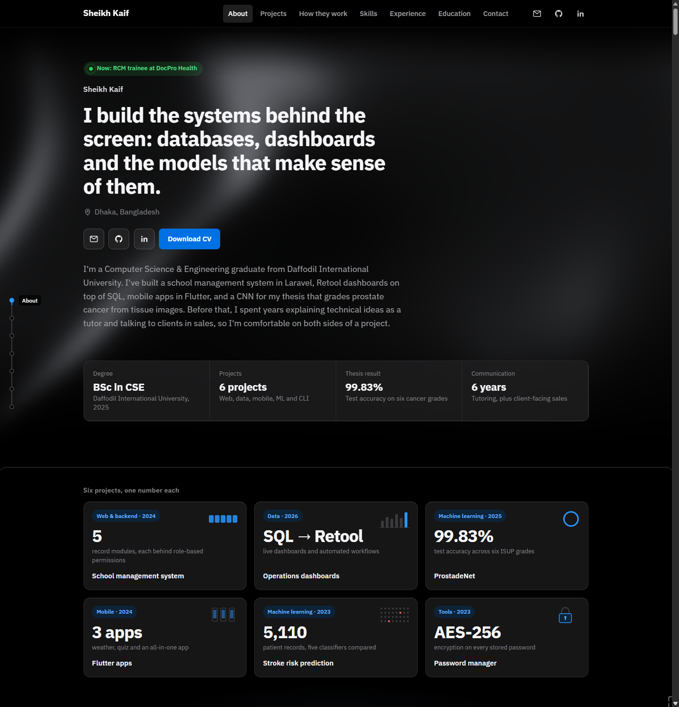

# Sheikh Kaif – Portfolio

Personal portfolio of Sheikh Kaif, a CSE graduate working on backends, data tools, mobile apps and machine learning, currently training in revenue cycle management at DocPro Health.

**Live site:** https://kaif15-14682.github.io/Personal-Portfolio/



## What's inside

- **Projects:** a Laravel school management system, Retool dashboards, the ProstadeNet thesis, Flutter apps, a stroke prediction notebook and a Bash password manager, each with a live visual and a case study.
- **How they work:** four scroll stories. A request travels through the school system's layers, a tissue tile goes through the thesis pipeline, a dot chart shows why 94% accuracy wasn't enough, and a sample medical claim moves through the revenue cycle, from eligibility and CPT/ICD-10-CM coding to denial, resubmission and payment.
- **Skills map:** every skill linked to the projects and roles that used it.
- **Experience, education and contact.**

## Tech

HTML, CSS and plain JavaScript, with WebGL for the hero background. GSAP with ScrollTrigger drives the scroll stories and Lenis smooths scrolling, both loaded from a CDN. No framework and no build step.

## Run locally

```bash
git clone https://github.com/kaif15-14682/Personal-Portfolio.git
cd Personal-Portfolio
```

Open `index.html` in a browser.

## Structure

```
index.html      Page content
styles.css      Styles
script.js       Interactions, scroll reveals, section rail and hero background
showpieces.js   Scroll stories, running mockups, case studies, skills map and RCM cycle ring
assets/         CV, favicon and preview image
```

## Contact

[Email](mailto:sheikhkaif977@gmail.com) · [LinkedIn](https://www.linkedin.com/in/sheikh-kaif-5bb86720b) · [GitHub](https://github.com/kaif15-14682)
