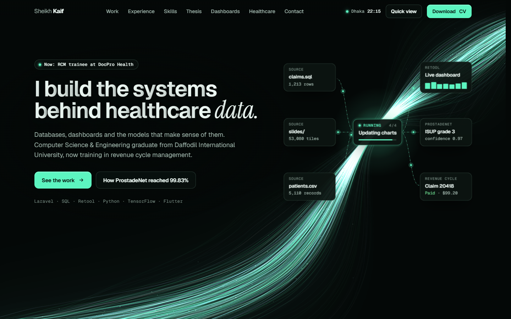

# Sheikh Kaif – Portfolio

Personal portfolio of Sheikh Kaif, a CSE graduate who builds the systems behind healthcare data: Laravel and SQL backends, Retool dashboards and machine learning models. Currently training in revenue cycle management at DocPro Health.

**Live site:** https://kaif15-14682.github.io/Personal-Portfolio/



## What's inside

- **Hero:** a live diagram of the work in three lanes: claim rows become a Retool dashboard, tissue slides become a ProstadeNet grade, and a day of patient visits becomes paid claims. The lanes take turns. Hovering a card shows what it does (phones show it under the diagram), and clicking it jumps to the part of the page where that work runs in full. A ribbon of light runs through the whole page.
- **Projects:** operations dashboards, the ProstadeNet thesis, a Laravel school management system, Rampart (a Bash tool that guards a data inbox), stroke risk prediction, Flutter apps and the Yui & Kai planner (a shared planner for two people on shift work). Each card has a live visual, a short description and links to how it works and to the code, and the list can be filtered by kind of work. Competitions from 2021 to 2025 close the list.
- **Experience:** five roles on a timeline. The light becomes the timeline's line, and each role charges in as you reach it.
- **Skills:** each skill, and where it was used.
- **ProstadeNet:** a tissue slide on its way to a grade, with feature maps computed in your browser, a sample tile of any grade from 0 to 5 to try, and the ten tuning steps that got there.
- **Dashboards:** a case study in three steps on sample data. The page generates 12 weeks of sample claims in your browser; a dashboard and two SQL queries find why first-pass acceptance dropped, and the last step shows the board after the fix. Every number on it is counted from those rows.
- **Stroke risk prediction:** why 94% accuracy wasn't enough.
- **Numbers from the projects, the Laravel system from the screen down to the database, and one medical claim from the front desk to paid.**
- **Contact.**

**Quick view:** the button in the top bar turns off the intro and the scroll animations and shows the whole page at once.

## Tech

One HTML file with plain CSS and JavaScript: no framework and no build step. A small WebGL2 renderer draws the ribbon of light, and browsers that can only draw WebGL in software get a CSS glow instead. GSAP with ScrollTrigger drives the pinned sections and Lenis smooths scrolling. Everything is served from this site, scripts and fonts included (Geist, Geist Mono and Instrument Serif, under the SIL Open Font License), so the page doesn't wait on any other server.

The page follows the reduced-motion setting, and the footer shows the page's weight and load time, measured in your browser.

Every push runs four checks in GitHub Actions: Lighthouse, the W3C HTML checker, a typo check and a broken-link check.

## Run locally

```bash
git clone https://github.com/kaif15-14682/Personal-Portfolio.git
cd Personal-Portfolio
python -m http.server 8000
```

Then open `http://localhost:8000`. Opening `index.html` straight from disk works too, but browsers don't load the fonts that way.

## Structure

```
index.html     The whole site: markup, styles and scripts
assets/        Tab and home-screen icons, share image and preview image
assets/fonts/  The three fonts, latin subset, with their licences
assets/js/     GSAP, ScrollTrigger and Lenis
```

## Contact

[Email](mailto:sheikhkaif977@gmail.com) · [LinkedIn](https://www.linkedin.com/in/sheikh-kaif) · [GitHub](https://github.com/kaif15-14682)
