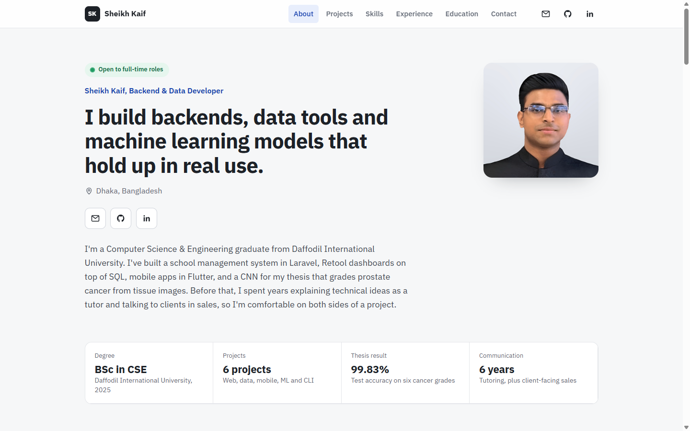

# Sheikh Kaif – Portfolio

Personal portfolio of **Sheikh Kaif**, a Computer Science & Engineering graduate from Daffodil International University based in Dhaka, Bangladesh. I work on backends, data tools, mobile apps and machine learning.

**Live site:** https://kaif15-14682.github.io/Personal-Portfolio/



## What's on the site

- **About:** a short introduction, my location, contact links, and a strip of key facts.
- **Projects:** six projects you can filter by area. Each one comes with a visual that shows how it works.
- **Skills:** a table that links each skill to the projects where I used it.
- **Experience:** a timeline of work and research.
- **Education & achievements:** degree, CGPA and competitions.
- **Contact:** email, plus a button that copies my address.

## Featured projects

| Project | Area | Stack | Code |
|---|---|---|---|
| School management system | Web & backend | Laravel, PHP, MySQL, Tailwind CSS | [Repository](https://github.com/kaif15-14682/School_Management_system_Laravel) |
| Operations dashboards | Data | Retool, SQL | Internal work |
| ProstadeNet: prostate cancer grading (thesis) | Machine learning | Python, TensorFlow, Keras, OpenCV | Report on request |
| Flutter apps: weather, quiz, calculator, combined | Mobile | Flutter, Dart, REST APIs | [Weather](https://github.com/kaif15-14682/Weather_App_Flutter) · [Quiz](https://github.com/kaif15-14682/Quiz_App_flutter) · [Calculator](https://github.com/kaif15-14682/Calculator_App_flutter) · [Combined](https://github.com/kaif15-14682/Combined_App_Flutter) |
| Stroke risk prediction | Machine learning | Python, pandas, scikit-learn | [Repository](https://github.com/kaif15-14682/Machine-Learning-project-for-AI) |
| Command-line password manager | Tools | Bash, OpenSSL | [Repository](https://github.com/kaif15-14682/Password-manager-using-bash) |

## Built with

- HTML, CSS and plain JavaScript: no framework and no build step
- [IBM Plex Sans and IBM Plex Mono](https://fonts.google.com/specimen/IBM+Plex+Sans) from Google Fonts
- Hand-written SVG for the charts and icons

Features:

- Works on phones and desktops
- Can be used with a keyboard alone
- Turns off animations for visitors who prefer reduced motion

## Project structure

```
Personal-Portfolio/
├── index.html          Page content
├── styles.css          Layout and colours (colour values are at the top)
├── script.js           Project filters, tabs, ablation chart, terminal animation, copy-email button
├── assets/
│   ├── profile.jpg     Portrait
│   ├── favicon.svg     Browser tab icon
│   └── screenshot.png  Image used in this README
└── README.md
```

## Run it locally

Clone the repository and open `index.html` in a browser:

```bash
git clone https://github.com/kaif15-14682/Personal-Portfolio.git
cd Personal-Portfolio
```

In VS Code, the **Live Server** extension reloads the page every time you save.

## Update the site

1. Edit the files.
2. Publish the changes:

   ```bash
   git add -A
   git commit -m "Describe the change"
   git push
   ```

GitHub Pages republishes the site within a minute or two.

### Add a downloadable CV

Save a public version of your CV as `assets/Sheikh_Kaif_CV.pdf`. Leave out the phone number, home address and reference contacts. The **Download CV** button appears automatically once that file exists.

## Contact

- Email: [sheikhkaif977@gmail.com](mailto:sheikhkaif977@gmail.com)
- LinkedIn: [sheikh-kaif-5bb86720b](https://www.linkedin.com/in/sheikh-kaif-5bb86720b)
- GitHub: [kaif15-14682](https://github.com/kaif15-14682)
