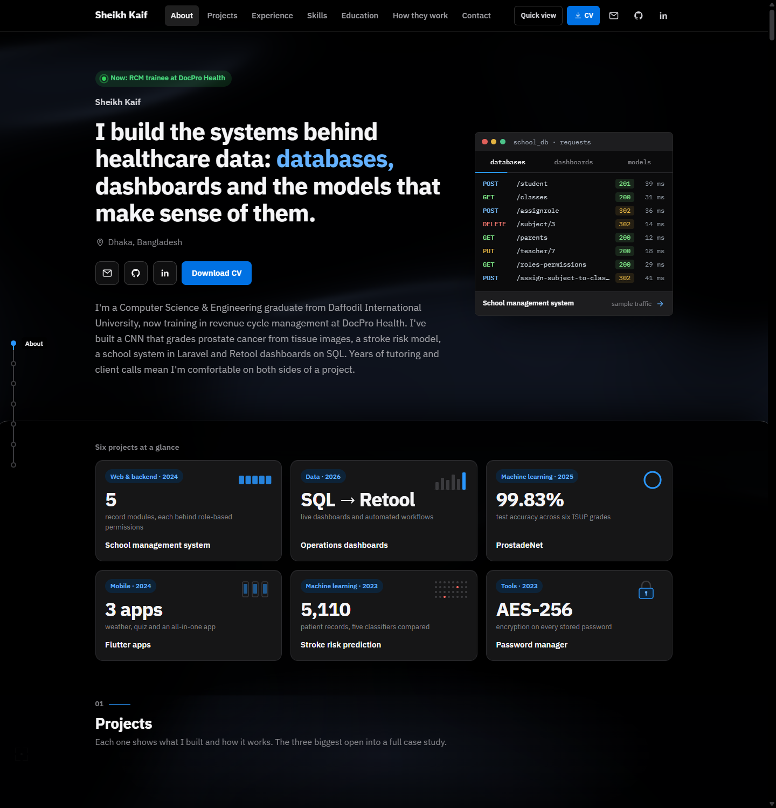

# Sheikh Kaif – Portfolio

Personal portfolio of Sheikh Kaif, a CSE graduate working on backends, data tools, mobile apps and machine learning, currently training in revenue cycle management at DocPro Health.

**Live site:** https://kaif15-14682.github.io/Personal-Portfolio/



## What's inside

- **Projects:** a Laravel school management system, Retool dashboards, the ProstadeNet thesis, Flutter apps, a stroke prediction notebook and a Bash password manager, each with a live visual. The three biggest open into a 20-second case study that plays on its own, followed by a hands-on demo.
- **Experience, skills map and education:** every skill linked to the projects and roles that used it.
- **How they work:** four scroll stories. A request travels through the school system's layers, a tissue tile goes through the thesis pipeline, a dot chart shows why 94% accuracy wasn't enough, and a sample medical claim moves through the revenue cycle, from eligibility and CPT/ICD-10-CM coding to denial, resubmission and payment.
- **Contact.**

**Quick view:** the button in the top bar shows the whole page at once, without the scroll stories. Add `?quick` to the link to open it that way.

## Tech

HTML, CSS and plain JavaScript, with WebGL for the midnight satin behind the page. GSAP with ScrollTrigger drives the scroll stories and Lenis smooths scrolling, both loaded from a CDN. No framework and no build step.

## Run locally

```bash
git clone https://github.com/kaif15-14682/Personal-Portfolio.git
cd Personal-Portfolio
```

Open `index.html` in a browser.

## Structure

```
index.html      Page content
styles.css      Styles
script.js       Interactions, scroll reveals, section rail and the satin background
showpieces.js   Scroll stories, the hero panel, running mockups, case studies, skills map and RCM cycle ring
assets/         CV, icons, share image and preview image
```

## Contact

[Email](mailto:sheikhkaif977@gmail.com) · [LinkedIn](https://www.linkedin.com/in/sheikh-kaif) · [GitHub](https://github.com/kaif15-14682)
